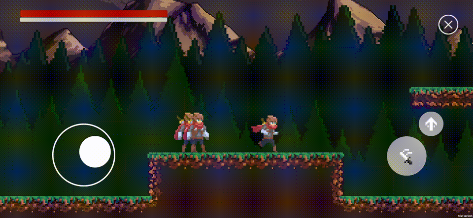
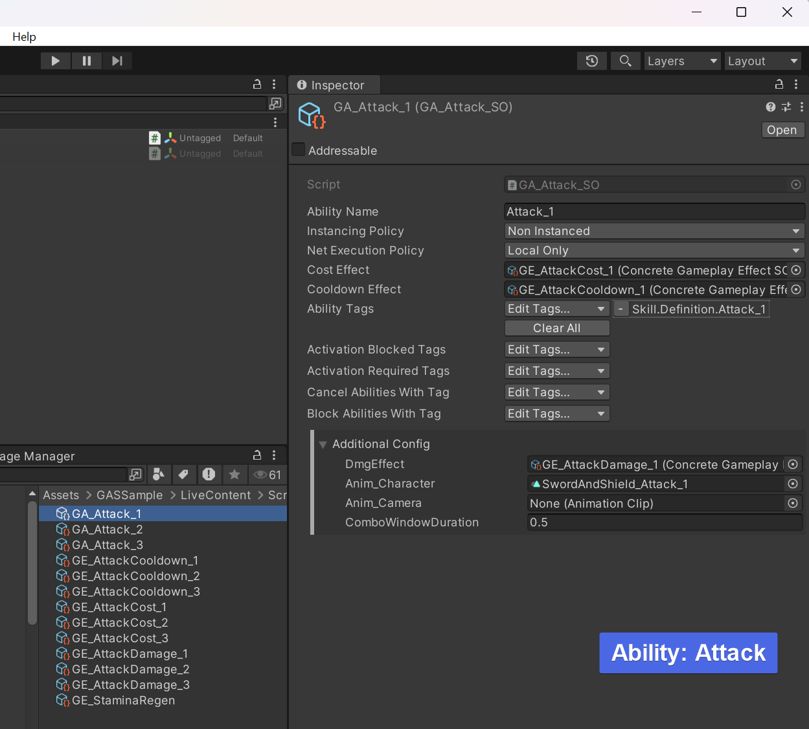

# Unity GameplayAbility Sample

<p align="left"><a href="README.md">English</a> | <strong>中文</strong></p>

---

[](https://deepwiki.com/MaiKuraki/UnityGameplayAbilitySystemSample)

基于 [CycloneGames GameplayAbilities](https://github.com/MaiKuraki/UnityStarter/tree/main/UnityStarter/Assets/ThirdParty/CycloneGames/CycloneGames.GameplayAbilities) 的 ARPG 战斗示例。

这个仓库同时可以作为项目结构的参考：AOT 启动层、可热更的内容层、一套不依赖第三方框架的场景流程、YAML 输入配置，以及编辑器工具。

## 概览

**战斗。** 三段攻击构成连招，每一段都是一个 `GameplayAbilitySO` 资产，带自己的动画片段、伤害效果、消耗和冷却。连招窗口是一个 GameplayTag，在窗口内再次按下攻击会激活下一段，而不是从第一段重新开始。

**属性。** `CharacterAttributeSet` 里有生命、体力、攻击力、防御、等级和经验。伤害要过一遍防御公式，死亡时打上状态标签，经验变化会去数据资产里查升级表。

**技能运镜。** `GA_Attack_3` 上挂着 `AbilityCameraClip` 和一份策略资产。技能播放期间，片段通过 `AbilityCinematicMode` 驱动 Cinemachine 相机；结束时相机会混合回第三人称视角。

**输入。** 键盘鼠标和手柄同时有效。绑定在 Input System 的配置窗口里编辑，保存到 `StreamingAssets/input_config.yaml`，改键不需要动代码。

**UI。** HUD 通过角色身上发布的事件读取生命、体力和经验。

## 目录

- [环境要求](#环境要求)
- [运行](#运行)
- [目录结构](#目录结构)
- [启动流程](#启动流程)
- [场景切换](#场景切换)
- [输入](#输入)
- [技能是怎么工作的](#技能是怎么工作的)
- [关键类与文件](#关键类与文件)
- [调试工具](#调试工具)
- [没有包含的部分](#没有包含的部分)

## 环境要求

- Unity **2022.3.62f3**（项目锁定在这个版本）
- Addressables 2.7.6、Input System 1.20.0、Cinemachine 3.1.7

## 运行

打开 `Assets/GASSample/BuiltIn/Scenes/Scene_Launch.unity`，按 Play。这是 Build Settings 里唯一的场景，其余场景都是运行时按地址加载的。

`WASD` / 左摇杆移动，鼠标左键 / 手柄 `A` 攻击。

## 目录结构

```
Assets/GASSample/
├─ BuiltIn/        AOT 侧：启动场景、根 Scope、内容加载器。随包发行。
├─ LiveContent/    热更侧资产：场景、预制体、美术资源、ScriptableObject。
├─ LiveScripts/    热更侧代码（单程序集 GASSample.HotUpdate）。
├─ Editor/         编辑器工具（GASSample.Editor），不会进包。
├─ Settings/       项目级资产，例如 VContainerSettings。
└─ _CHEAT/         可选调试面板，独立程序集，可以从构建里剔除。
```

拆分规则只有一条：`BuiltIn` 里不能出现任何指向 `LiveContent` 的资产引用。守住这条，热更层以后才能独立成程序集或者搬到远端包。目前两层之间唯一的联系是 `LaunchBootstrapper` 里的一个路径字符串。

## 启动流程

```
Scene_Launch                    BuiltIn，没有相机，只有一块黑幕
  └─ RootLifetimeScope          由 VContainerSettings 创建，注册 IAssetModule
      └─ LaunchBootstrapper     初始化资源包，然后
          └─ ProjectSharedLifetimeScope.prefab    按路径从 LiveContent 加载
              └─ BootEntryPoint 生成相机 / UI / EventSystem / 调试工具，
                                初始化输入，加载标题场景
```

`ProjectSharedLifetimeScope` 会存活整个会话。各场景的 Scope 是它的子级，每次换场景都会重建。

## 场景切换

`SceneFlow.LoadAsync` 只做一件事：在屏幕已经被盖住的前提下加载场景，它自己不负责淡出。顺序是固定的：

```csharp
await ScreenFade.FadeOutAsync();          // 调用方盖住屏幕
await uiService.CloseAsync(WindowId);     // 调用方关掉自己的 UI
await SceneFlow.LoadAsync(...);           // 换场景，旧句柄在这里回收
// 新场景准备就绪后自己淡入
```

最后一行容易被忽略：淡入由新场景自己决定，等它自己的内容就绪之后再做。`TitleEntryPoint` 等标题窗口打开，`GASSampleGameplayEntryPoint` 等世界和角色生成。如果加载完就淡入，会看到几帧空天空盒，因为相机还停在上一个场景的位置。

加一个场景：放到 `LiveContent/Scenes`（这个目录已经标记成 addressable），挂一个父级为 `ProjectSharedLifetimeScope` 的 `LifetimeScope`，再写一个 `IAsyncStartable` 入口，做完自己的事之后调用 `ScreenFade.FadeInAsync()`。

## 输入

输入由 [CycloneGames.InputSystem](https://github.com/MaiKuraki/UnityStarter/tree/main/UnityStarter/Assets/ThirdParty/CycloneGames/CycloneGames.InputSystem) 负责。绑定保存在 `Assets/StreamingAssets/input_config.yaml`，运行时通过每个玩家的 action id 读取。键鼠和手柄会同时保持配对，从鼠标切到手柄不需要重新 join。

### 改键

打开 `Tools → CycloneGames → Input System Editor`。这个窗口编辑的是整份配置：玩家槽位、context、action、设备绑定。改完写回磁盘：

- **Save Project Default**：写入 `Assets/StreamingAssets/input_config.yaml`，也就是游戏启动时加载的那个文件。
- **Save User + Generate Code**：额外重新生成 action 常量。输出目录和命名空间在窗口顶部设置。本项目的常量在 `LiveScripts/Shared/Input/InputActions.cs`，命名空间是 `GASSample.Input.Generated`，生成前先把这两个字段指过去，否则会多出一份没人引用的常量文件。

新增 action 时，运行时那侧的写法不变：按 id 取 observable，绑一个 command。

```csharp
new InputContext(InputActions.ActionMaps.PlayerActions, InputActions.Contexts.Gameplay)
    .AddBinding(player.GetButtonObservable(InputActions.Actions.Gameplay_Attack), new ActionCommand(HandleAttackInput));
```

两个约束容易忽略：

- 校验器不接受内联 composite，比如 `2DVector(up=<Keyboard>/w,...)`。用 `compositeBindings` 块，配置窗口写出来的就是这个格式。
- action 资产只监听配对到玩家 `InputUser` 上的设备。`InputDeviceSync` 负责把这份列表补齐，因为 XInput 在手柄重连后会留下一个死掉的克隆设备。

## 技能是怎么工作的

标签写在 `GASSampleTags.*.cs` 的几个 partial 里，通过显式 catalog 注册。程序集扫描过不了 IL2CPP 裁剪，也过不了热更，所以这里是手写注册。

一个 `GA_Attack_SO` 资产持有动画片段、伤害效果、消耗和冷却效果、连招窗口时长以及运镜片段。对应的运行时类 `GA_Attack` 读取这些字段并和 `AbilitySystemComponent` 交互：

```
输入 -> GASSamplePlayerCharacter.HandleAttackInput
     -> AbilitySystemComponent.TryActivateAbility
     -> GA_Attack.OnActivateAbility   （动画、消耗、冷却、运镜）
```

## 关键类与文件

| 主题 | 文件 |
| --- | --- |
| 游戏启动 | `BuiltIn/Scripts/LaunchBootstrapper.cs`，然后 `LiveScripts/Scene/Boot/BootEntryPoint.cs` |
| 场景切换 | `LiveScripts/Scene/SceneFlow.cs`、`ScreenFade.cs` |
| Pawn 怎么装配技能系统 | `LiveScripts/Gameplay/Framework/GASSampleCharacter.cs` |
| 输入怎么变成连招 | `LiveScripts/Gameplay/GASSamplePlayerCharacter.cs` |
| 技能的实现 | `LiveScripts/Gameplay/GAS/GA_Attack_SO.cs` |
| 伤害和升级 | `LiveScripts/Gameplay/GAS/CharacterAttributeSet.cs` |
| 运镜 | `LiveScripts/Gameplay/GAS/Camera/` |

## 调试工具

`_CHEAT` 里是游戏内控制台和调试面板（FPS、作弊指令）。配置和使用方法见 [CycloneGames.Cheat](https://github.com/MaiKuraki/UnityStarter/tree/main/UnityStarter/Assets/ThirdParty/CycloneGames/CycloneGames.Cheat)。

## 预览

-   战斗与连招：
-   技能资产 Inspector：

## 没有包含的部分

- 动画资源没有 RootMotion，也没有 IK。代码路径是有的，片段里没有。
- 没有 AI 敌人、没有存档、没有装备。

## 相关链接

- [CycloneGames GameplayAbilities](https://github.com/MaiKuraki/UnityStarter/tree/main/UnityStarter/Assets/ThirdParty/CycloneGames/CycloneGames.GameplayAbilities)
- [CycloneGames GameplayTags](https://github.com/MaiKuraki/UnityStarter/tree/main/UnityStarter/Assets/ThirdParty/CycloneGames/CycloneGames.GameplayTags)
- [UnityStarter](https://github.com/MaiKuraki/UnityStarter)

旧版本在 `Legacy(Zenject)` 分支上归档，不再维护。
