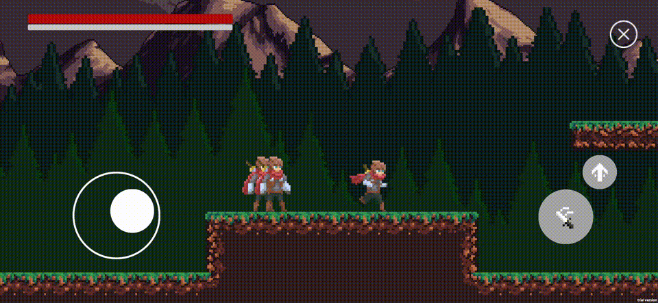
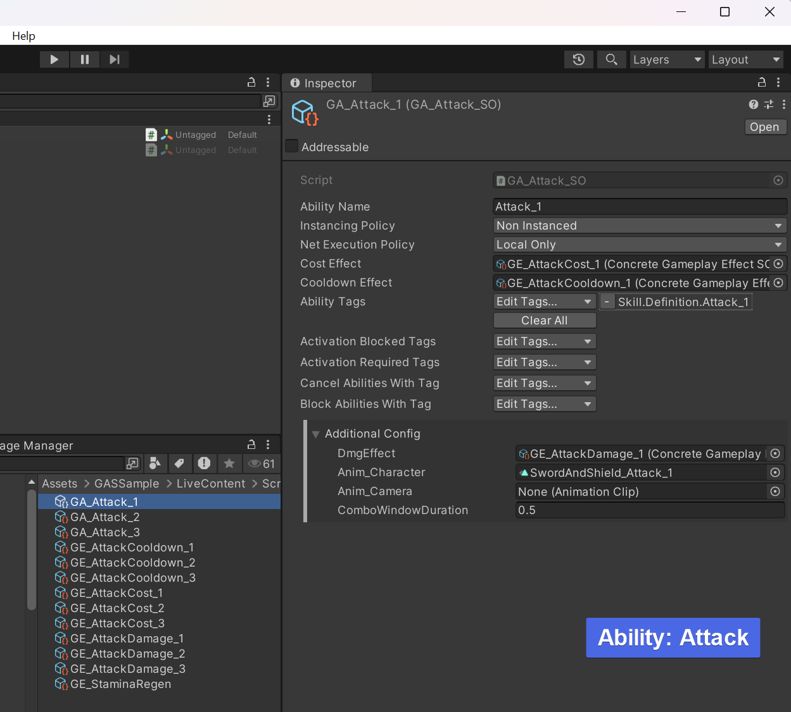

# Unity GameplayAbility Sample

<p align="left"><strong>English</strong> | <a href="README.SCH.md">中文</a></p>

---

[](https://deepwiki.com/MaiKuraki/UnityGameplayAbilitySystemSample)

An ARPG combat demo built on [CycloneGames GameplayAbilities](https://github.com/MaiKuraki/UnityStarter/tree/main/UnityStarter/Assets/ThirdParty/CycloneGames/CycloneGames.GameplayAbilities).

The repository also works as a structural reference: an AOT boot layer, a hot-updatable content layer, a scene flow with no third-party framework, YAML input, and editor tooling.

## Overview

**Combat.** Three attacks form a combo. Each one is a `GameplayAbilitySO` asset with its own animation clip, damage effect, cost and cooldown. The combo window is a gameplay tag, so pressing attack inside the window activates the next skill instead of restarting the first one.

**Attributes.** `CharacterAttributeSet` holds health, stamina, attack power, defense, level and experience. Damage passes through a defense formula, death applies a tag, and experience triggers a level-up lookup from a data asset.

**Ability camera.** `GA_Attack_3` carries an `AbilityCameraClip` and a policy asset. While the skill runs, the clip drives a Cinemachine camera through `AbilityCinematicMode`; when it ends, the camera blends back to the third-person view.

**Input.** Keyboard/mouse and gamepad stay live at the same time. Bindings are authored in the Input System editor window and saved to `StreamingAssets/input_config.yaml`, so remapping keys does not require a code change.

**UI.** The HUD reads health, stamina and experience through events published by the player character.

## Contents

- [Requirements](#requirements)
- [Run it](#run-it)
- [Project layout](#project-layout)
- [How the game starts](#how-the-game-starts)
- [Scene flow](#scene-flow)
- [Input](#input)
- [Working with abilities](#working-with-abilities)
- [Key files and classes](#key-files-and-classes)
- [Debug tooling](#debug-tooling)
- [Not included](#not-included)

## Requirements

- Unity **2022.3.62f3** (the project is pinned to this version)
- Addressables 2.7.6, Input System 1.20.0, Cinemachine 3.1.7

## Run it

Open `Assets/GASSample/BuiltIn/Scenes/Scene_Launch.unity` and press Play. That scene is the only Build Settings entry; every other scene is an addressable loaded at runtime.

`WASD` / left stick to move. Left mouse button / gamepad `A` to attack.

## Project layout

```
Assets/GASSample/
├─ BuiltIn/        AOT side: launch scene, root scope, content loader. Ships with the player.
├─ LiveContent/    Hot side assets: scenes, prefabs, art, ScriptableObjects.
├─ LiveScripts/    Hot side code (one assembly: GASSample.HotUpdate).
├─ Editor/         Editor-only tools (GASSample.Editor). Never in a build.
├─ Settings/       Project-level assets such as VContainerSettings.
└─ _CHEAT/         Optional debug panel. Own assembly, can be dropped from a build.
```

The rule behind the split: `BuiltIn` must not hold a single asset reference into `LiveContent`. As long as that holds, the hot side can move into its own assembly or a remote package later. Right now the only link between the two is one path string in `LaunchBootstrapper`.

## How the game starts

```
Scene_Launch                    BuiltIn, no camera, just a black cover
  └─ RootLifetimeScope          created by VContainerSettings, registers IAssetModule
      └─ LaunchBootstrapper     initializes the asset package, then
          └─ ProjectSharedLifetimeScope.prefab    loaded by path out of LiveContent
              └─ BootEntryPoint spawns camera / UI / event system / debug tools,
                                initializes input, loads the title scene
```

`ProjectSharedLifetimeScope` lives for the whole session. Scene scopes are its children and get rebuilt on every scene load.

## Scene flow

`SceneFlow.LoadAsync` does one thing: load a scene while the screen is already covered. It does not fade. The order is fixed:

```csharp
await ScreenFade.FadeOutAsync();          // caller covers the screen
await uiService.CloseAsync(WindowId);     // caller hides its own UI
await SceneFlow.LoadAsync(...);           // load; the previous handle is retired
// the loaded scene fades in itself once it is ready
```

The last line is easy to miss: the incoming scene decides when to fade in, after its own content exists. `TitleEntryPoint` waits for the title window, `GASSampleGameplayEntryPoint` waits for the world and the player. Fading in right after the load instead shows a few frames of empty sky, because the camera still sits where the previous scene left it.

Adding a scene: put it under `LiveContent/Scenes` (that folder is marked addressable), give it a `LifetimeScope` parented to `ProjectSharedLifetimeScope`, and write an `IAsyncStartable` entry point that does its work and then calls `ScreenFade.FadeInAsync()`.

## Input

Input is handled by [CycloneGames.InputSystem](https://github.com/MaiKuraki/UnityStarter/tree/main/UnityStarter/Assets/ThirdParty/CycloneGames/CycloneGames.InputSystem). Bindings are stored in `Assets/StreamingAssets/input_config.yaml` and consumed at runtime through per-player action ids. Both devices stay paired, so moving from mouse to gamepad needs no re-join.

### Editing bindings

Open `Tools → CycloneGames → Input System Editor`. The window edits the whole configuration: player slots, contexts, actions and device bindings. It writes the result back to disk:

- **Save Project Default** writes `Assets/StreamingAssets/input_config.yaml`, the file the game loads at boot.
- **Save User + Generate Code** also regenerates the action constants. The output folder and namespace are set at the top of the window. In this project the constants live in `LiveScripts/Shared/Input/InputActions.cs` under `GASSample.Input.Generated`, so point the window there before generating; otherwise you get a second constants file that nothing references.

Runtime wiring does not change when you add an action: resolve it by id and bind a command.

```csharp
new InputContext(InputActions.ActionMaps.PlayerActions, InputActions.Contexts.Gameplay)
    .AddBinding(player.GetButtonObservable(InputActions.Actions.Gameplay_Attack), new ActionCommand(HandleAttackInput));
```

Two constraints are easy to miss:

- The validator rejects inline composites such as `2DVector(up=<Keyboard>/w,...)`. Use the `compositeBindings` block; the editor window writes it in that form.
- The action asset only listens to devices paired to the player's `InputUser`. `InputDeviceSync` keeps that list complete, because XInput leaves a dead device clone behind when a controller reconnects.

## Working with abilities

Tags are declared in the `GASSampleTags.*.cs` partials through an explicit catalog. Assembly scanning does not survive IL2CPP stripping or a hot update, so registration is manual on purpose.

A `GA_Attack_SO` asset holds the animation clip, damage effect, cost and cooldown effects, combo window length and the camera clip. Its runtime counterpart `GA_Attack` reads those fields and talks to `AbilitySystemComponent`:

```
input -> GASSamplePlayerCharacter.HandleAttackInput
      -> AbilitySystemComponent.TryActivateAbility
      -> GA_Attack.OnActivateAbility   (animation, cost, cooldown, camera)
```

## Key files and classes

| Topic | File |
| --- | --- |
| Game boot | `BuiltIn/Scripts/LaunchBootstrapper.cs`, then `LiveScripts/Scene/Boot/BootEntryPoint.cs` |
| Scene switching | `LiveScripts/Scene/SceneFlow.cs`, `ScreenFade.cs` |
| Ability system setup on a pawn | `LiveScripts/Gameplay/Framework/GASSampleCharacter.cs` |
| Input to combo | `LiveScripts/Gameplay/GASSamplePlayerCharacter.cs` |
| Skill implementation | `LiveScripts/Gameplay/GAS/GA_Attack_SO.cs` |
| Damage and level up | `LiveScripts/Gameplay/GAS/CharacterAttributeSet.cs` |
| Cinematic camera | `LiveScripts/Gameplay/GAS/Camera/` |

## Debug tooling

`_CHEAT` holds an in-game console and a debug sheet (FPS counter, cheat commands). Setup and usage are documented in [CycloneGames.Cheat](https://github.com/MaiKuraki/UnityStarter/tree/main/UnityStarter/Assets/ThirdParty/CycloneGames/CycloneGames.Cheat).

## Preview

-   Combat and combo: 
-   Ability asset inspector: 

## Not included

- The animation clips have no root motion and no IK. The code path exists, the clips do not.
- No AI enemies, no save system, no equipment.

## Links

- [CycloneGames GameplayAbilities](https://github.com/MaiKuraki/UnityStarter/tree/main/UnityStarter/Assets/ThirdParty/CycloneGames/CycloneGames.GameplayAbilities)
- [CycloneGames GameplayTags](https://github.com/MaiKuraki/UnityStarter/tree/main/UnityStarter/Assets/ThirdParty/CycloneGames/CycloneGames.GameplayTags)
- [UnityStarter](https://github.com/MaiKuraki/UnityStarter)

Older versions of this project live on the `Legacy(Zenject)` branch. They are archived and no longer maintained.
